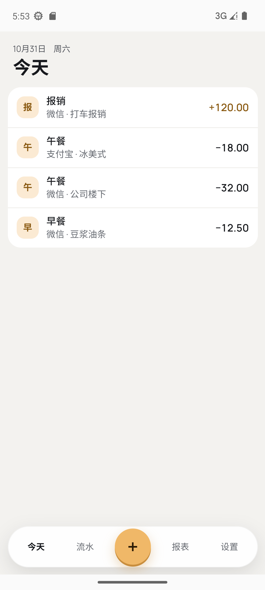
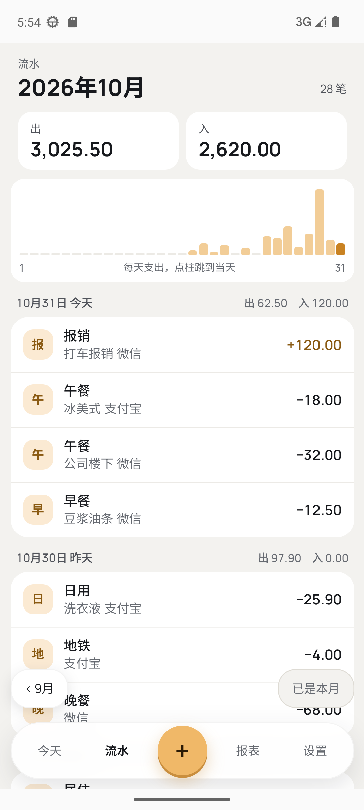

# 记账本（Ledger）

一个自用的、离线的 Android 记账应用：本地 SQLite、整数分记账、无网络权限。

> 当前状态：个人项目，UI v1 已落地，709 个测试通过。欢迎围观和提 issue，但项目仍会按自己的节奏演进。

<p align="center">
  
  
</p>

## 功能

- **今天 / 流水 / 报表 / 设置** 四个主屏；
- **随手记**：支出 / 收入 / 转账，支持分类、账户、标签、项目、日期、备注；
- **编辑流水**：分类、账户、标签、项目可改；日期保存后只读；删除是页内二次确认；
- **账户**：余额、对账、改名、月度额度、归档；
- **分类 / 标签**：两级分类、标签搜索、归档与恢复；
- **项目**：项目可挂支出或收入；「已花」只统计支出，收入计入笔数与明细；
- **固定支出**：只做清单和建议，不自动记账；
- **备份与恢复**：导出/导入 `.ledger` 文件，导入前先备份当前账本；
- **存储**：选择备份目录；
- **金额**：全程整数分，显示两位小数、千分位和 U+2212 负号；
- **转账**：两条腿都展示，但不计入出/入合计；
- **数字键盘**：所有金额输入共用应用内键盘，不唤起系统输入法。

## 技术栈

- React 19 + TypeScript
- Vite 8
- Capacitor 8
- `@capacitor-community/sqlite`
- 原生 Android 外壳（Java）
- Vitest（SSR + 真 SQLite）

Android 包名：`io.github.wuyueea.todaycents`，最低 Android 8.0（API 26）。没有引入 UI 组件库；没有运行时网络请求。

## 开发

### 环境

- Node.js 22+
- pnpm 11+
- JDK 21
- Android SDK（含 platform-tools、build-tools；具体版本见 `android/variables.gradle`）

### 安装与测试

```bash
pnpm install
pnpm test
pnpm build
```

### 构建 Android APK

Debug 包：

```bash
pnpm run build:android
```

```text
android/app/build/outputs/apk/debug/app-debug.apk
```

Release 签名包：

```bash
pnpm run build:android:release
```

```text
android/app/build/outputs/apk/release/app-release.apk
```

Release 构建会在仓库根目录读取 `keystore.properties`（不要提交）；没有该文件时只能生成未签名包。密钥和密码必须自行备份。

## 数据与隐私

- 数据只存在本机 SQLite，不上传、不联网、不做统计。
- 备份文件由用户主动触发，写入用户选择的目录。
- 应用没有 `INTERNET` 权限。
- Android 使用了 `MANAGE_EXTERNAL_STORAGE`，用于把备份写入普通文件夹；这是很宽的权限，只适合自用/侧载。
- 详见 [PRIVACY.md](PRIVACY.md)。

## 字体

- 数字、英文、符号：**Manrope**，OFL-1.1；
- 中文：**Noto Sans SC**，OFL-1.1；
- 字体文件随项目本地打包，运行时不访问 Google Fonts；
- 许可证文本在 `public/licenses/` 与 `src/assets/fonts/`。

## 许可证

代码以 [MIT](LICENSE) 发布。第三方依赖与字体的许可见 [THIRD_PARTY_NOTICES.md](THIRD_PARTY_NOTICES.md)。
